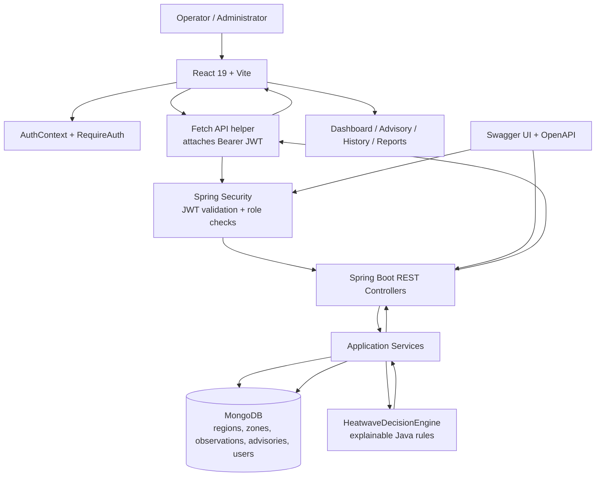

# Final Phase 3 Architecture

## Request sequence: generate an advisory

1. An authenticated operator enters weather measurements in React.
2. `frontend/src/api.js` sends the JSON request with `Authorization: Bearer <accessToken>`.
3. Spring Security validates the JWT signature, issuer and expiry before the request reaches the controller.
4. `ObservationController` and `ObservationService` validate and save the observation in MongoDB.
5. The user requests advisory generation using the persisted observation ID.
6. `AdvisoryController` delegates to `AdvisoryService`; the service loads the observation, monitoring zone and parent region.
7. `HeatwaveDecisionEngine` evaluates the configured deterministic rules and creates an explainable result.
8. `AdvisoryService` persists the advisory as a separate MongoDB document.
9. The API returns the saved advisory; React renders its severity, reasoning, recommendations and history details.

## Security boundaries

| Area | Access |
|---|---|
| `/api/auth/register`, `/api/auth/login` | Public |
| `/api/health`, `/actuator/health` | Public |
| Swagger/OpenAPI paths | Public documentation; protected operations still require JWT |
| GET `/api/regions/**`, GET `/api/zones/**` | Authenticated user |
| Write operations under `/api/regions/**`, `/api/zones/**` | `ADMIN` role |
| Other `/api/**` application endpoints | Authenticated user |

Public registration creates an `OPERATOR`, never an administrator. An initial `ADMIN` is created only when `APP_ADMIN_USERNAME` and `APP_ADMIN_PASSWORD` are supplied at backend startup and that username does not already exist.

## Data and model boundary

All weather measurements are manually entered. The Java rule engine is deterministic and explainable; it is not a trained ML model and does not call an external weather service. The prototype's thresholds and simplified Heat Index calculation are demonstration parameters, not official IMD warning criteria.
